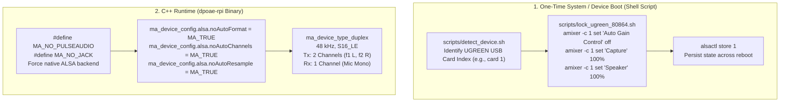

# OAE Buds — Comprehensive RPi5 C++ Porting Implementation Plan

## Executive Summary & Decisions Locked Down

| Parameter | Specification | Engineering Rationale / Validation |
|:--|:--|:--|
| **Earphones / Transducers** | Sony MDR-EX14AP drivers | 9 mm dynamic drivers, 16 Ω @ 1 kHz, 100 dB/mW sensitivity. Two separate drivers extracted and fitted into a single custom probe enclosure (f1 Left, f2 Right). |
| **Microphone** | PUI Audio POM-2730L-HD-R | Omnidirectional electret condenser microphone (ECM), −30 ± 3 dB sensitivity (at 1 kHz, 0 dB = 1V/Pa), 20 Hz – 20 kHz, 74 dB SNR, 2.2 kΩ output impedance, 1V – 10V operating voltage. |
| **DAC / ADC Interface** | UGREEN 80864 USB Audio Adapter | USB Audio Class (UAC) 1.0 compliant, C-Media chipset. Stereo 16-bit/48 kHz playback + mono 16-bit/48 kHz capture via single 3.5 mm TRRS jack. Tested & verified on RPi5. |
| **Connector & Pinout** | Single 3.5 mm CTIA TRRS | **Tip**: Driver 1 (+) [f1 Left]; **Ring 1**: Driver 2 (+) [f2 Right]; **Ring 2**: Common Ground (GND); **Sleeve**: Microphone (+) [signal & bias]. |
| **Audio I/O Architecture** | **miniaudio** (PCM) + **ALSA `amixer`** (Mixer lock) | `miniaudio` handles duplex non-resampled PCM streaming (`noAutoFormat`, `noAutoChannels`, `noAutoResample`); pre-test ALSA script locks hardware AGC to `off` and pins volumes. |
| **Target OS & Toolchain** | Raspberry Pi OS Trixie Lite (64-bit) | Debian 13 (Trixie) base with GCC 14 (native C++20), CMake 3.28+, `libasound2-dev`, `libfftw3-dev`. Headless image has no PulseAudio/PipeWire daemon to hijack streams. |
| **Build Target** | Native compilation on RPi5 | Direct build on device via `cmake -B build && cmake --build build`. |
| **Baseline Profile** | `sch3` baseline in `oae_config.toml` | All smartphone profiles (`sch`, `sch2`, `sch3`, `pixel_calib`, `doogee_calib`, `infinix_calib`, `s9_calib`) preserved in TOML; RPi target initialized with `sch3` pending Step 8 calibration. |
| **DSP Bug Fixes** | `ampCheck()` & `checkfit()` | Reset `summer = 0` per 1000 samples and use `std::abs()` in `ampCheck()`; make `fit_check` optional via TOML config and handle non-Samsung profiles without null-pointer crashes. |
| **Outputs & CLI** | Headless CLI, JSON + WAV | One-shot execution: prints human-readable screening progress to stdout; outputs structured JSON report + 16-bit mono 48 kHz WAV recordings per test frequency. |

---

## 1. Hardware Architecture & Acoustic Probe Design

### 1.1 Custom Enclosure Acoustic Configuration

In clinical Distortion-Product Otoacoustic Emission (DPOAE) screening, two primary pure tones ($f_1$ and $f_2$, where $f_2 / f_1 \approx 1.22$) are delivered simultaneously into the sealed external ear canal:

```
+-----------------------------------------------------------------------------------+
|                            CUSTOM OAE PROBE ENCLOSURE                             |
|                                                                                   |
|  +--------------------+                                                           |
|  | Sony Driver 1 (L)  |====[ Acoustic Sound Tube 1 (f1) ]====\                    |
|  | (16 ohm, 9mm)      |                                      |                    |
|  +--------------------+                                      |                    |
|                                                              +==[ Silicone /     ]| -> Sealed Ear
|  +--------------------+                                      |  [ Foam Ear Tip   ]|    Canal
|  | Sony Driver 2 (R)  |====[ Acoustic Sound Tube 2 (f2) ]====/                    |
|  | (16 ohm, 9mm)      |                                      |                    |
|  +--------------------+                                      |                    |
|                                                              |                    |
|  +--------------------+                                      |                    |
|  | PUI POM-2730L-HD-R |<===[ Acoustic Port / Filter ]========/                    |
|  | Microphone (ECM)   |                                                           |
|  +--------------------+                                                           |
+-----------------------------------------------------------------------------------+
```

> [!IMPORTANT]
> **Acoustic Mixing vs. Electrical Mixing**: The $f_1$ and $f_2$ pure tones **must never be summed electrically** into a single transducer. When two high-level pure tones drive a single speaker diaphragm, the physical non-linearity of the speaker suspension generates mechanical intermodulation distortion at $2f_1 - f_2$, perfectly mimicking a living ear emission! By driving Driver 1 strictly with Left channel ($f_1$) and Driver 2 strictly with Right channel ($f_2$), the tones mix solely in the air volume of the ear canal.

### 1.2 3.5 mm TRRS Plug Wiring & Bias Voltage Verification

The UGREEN 80864 adapter provides a single 4-pole 3.5 mm TRRS jack wired according to the **CTIA / AHJ** standard:

| TRRS Contact | Channel / Function | Transducer Connection | Electrical Characteristics |
|:---|:---|:---|:---|
| **Tip (T)** | Left Playback Out | Sony Driver 1 (+) terminal | $16\ \Omega$ nominal impedance; driven with pure tone $f_1$. |
| **Ring 1 (R1)** | Right Playback Out | Sony Driver 2 (+) terminal | $16\ \Omega$ nominal impedance; driven with pure tone $f_2$. |
| **Ring 2 (R2)** | Common Return (GND) | Driver 1 (-), Driver 2 (-), Mic (-) | Ground plane and cable shield. |
| **Sleeve (S)** | Microphone In + Bias | PUI POM-2730L-HD-R (+) terminal | Electret microphone terminal receiving $\approx 2.5\text{--}3.0\text{ V}$ DC bias from UGREEN internal load resistor. |

```
        Tip (L / f1)      Ring 1 (R / f2)    Ring 2 (GND)    Sleeve (Mic + Bias)
          |---|             |---|             |---|             |---|
         /     \           /     \           /     \           /     \
    ====+       +=========+       +=========+       +=========+       +======[ Cable ]
         \     /           \     /           \     /           \     /
          |---|             |---|             |---|             |---|
```

### 1.3 Critical Electrical Crosstalk Risk & Mitigation Protocol

Because both $16\ \Omega$ low-impedance dynamic drivers and the high-gain electret microphone preamp share a single common return conductor (Ring 2), any parasitic ground contact resistance ($R_{\text{gnd}} \approx 0.2\text{--}1.0\ \Omega$) will produce a return voltage drop:
$$V_{\text{gnd}}(t) = R_{\text{gnd}} \cdot \left[ I_{f_1}(t) + I_{f_2}(t) \right]$$
If non-linear components in the ADC or codec reference this modulated ground, an electrical artifact at $2f_1 - f_2$ will appear in the capture stream, causing false "Pass" results in dead cavities.

**Mitigation Protocol (Enforced in Step 8)**:
1. Prior to human testing, the probe must be inserted into an acoustic 2cc coupler (or airtight plastic syringe).
2. The system executes the full stimulus battery at $65\text{ dB SPL}\ (f_1)$ and $55\text{ dB SPL}\ (f_2)$.
3. The FFT power at bin $2f_1 - f_2$ is evaluated:
   - **Acceptance Threshold**: IMD in passive cavity must be **$< -15\text{ dB SPL}$** (below biological noise floor).
   - **Action if Failed**: If crosstalk exceeds $-15\text{ dB SPL}$, rewire the probe cable using star-grounding or separate TRS playback and TRS recording cables into a dual-jack USB interface.

---

## 2. Audio Subsystem: Hybrid miniaudio + ALSA Design

### 2.1 Why miniaudio Alone Cannot Handle Hardware AGC

`miniaudio` is an audio stream transport library. It does not provide an API to enumerate or modify hardware mixer controls (`snd_mixer_elem_t`) in the ALSA kernel driver. In Linux USB Audio Class devices:
- Automatic Gain Control (AGC) is implemented in the USB sound card's internal microcontroller.
- If ALSA's mixer element `Auto Gain Control` remains enabled (`on`), the card's firmware dynamically compresses and amplifies the mic preamp based on instantaneous volume, destroying DPOAE calibration and SNR measurements.
- Furthermore, software sound servers (PulseAudio or PipeWire) often insert dynamic volume normalizers.

### 2.2 The Hybrid Architecture



---

## 3. Complete TOML Configuration Schema (`oae_config.toml`)

The configuration file consolidates all clinical thresholds, frequencies, and smartphone empirical calibration profiles:

```toml
# ==============================================================================
# OAE Buds — DPOAE Screening Configuration (TOML)
# ==============================================================================

[audio]
sample_rate = 48000
bit_depth = 16
recording_window_seconds = 1.5
play_window_ms = 1500
process_window_length_factor = 1.0       # 1.0 * 48000 = 48000 samples (1.0 s)
init_signal_trim_factor = 1.0            # 1.0 * 48000 = 48000 samples (1.0 s trimmed)

[test]
snr_threshold_db = 7.0                   # Standard clinical DPOAE pass criterion (>= 7 dB SNR)
spl_threshold_db = -50.0                 # Minimum emission SPL threshold
max_tries = 1                            # Number of retries per frequency pair
constant_tone_seconds = 5                # Duration of dual-tone stimulus presentation per pair
pass_rule_min_frequencies = 3            # Must pass >= 3 of 4 frequencies for overall PASS

[artifact_rejection]
enabled = true
art_threshold_db = 4.0                   # If broadband artifact energy jumps >= 4 dB, reject block
snr_floor_db = -25.0                     # If SNR < -25 dB, reject block
imd_threshold = 200.0                    # If 2f2-f1 IMD spike SNR > 200, subtract IMD from SNR
amp_threshold = 500                      # Initial block amplitude check threshold (fixed mean abs)

[fit_check]
enabled = false                          # Probe seal check before test (toggle via CLI --fit-check)
check_frequency_hz = 226                 # 226 Hz standard tympanometric probe tone
seal_check_threshold = 200               # Lower envelope threshold (loose seal if below)
seal_occlusion_threshold = 500           # Upper envelope threshold (blocked/occluded probe if above)
consecutive_pass_buffers = 25            # Must maintain valid envelope for 25 consecutive buffers
calib_signal = "tone"                    # "tone" (226 Hz) or "chirp"
tone_volume = 0.6                        # Playback volume for 226 Hz fit check

[volume_calibration]
enabled = true                           # Run in-ear volume calibration sequence before test
chirp_start_hz = 1000.0
chirp_end_hz = 4000.0
chirp_duration_seconds = 0.1
tone_duration_seconds = 0.2
examine_duration_seconds = 0.1
pad_duration_seconds = 0.05
latency_search_window_seconds = 0.5      # First 0.5 s searched via cross-correlation

# Active and supported frequency pairs:
# At Fs = 48000 Hz with N = 48000 samples, bin index == frequency in Hz exactly!

[[frequency_pairs]]
f2 = 2016
f1 = 1640
oae_bin = 1264                           # 2*1640 - 2016 = 1264 Hz
imd_bin = 2392                           # 2*2016 - 1640 = 2392 Hz
active = true

[[frequency_pairs]]
f2 = 2953
f1 = 2438
oae_bin = 1923                           # 2*2438 - 2953 = 1923 Hz
imd_bin = 3468                           # 2*2953 - 2438 = 3468 Hz
active = true

[[frequency_pairs]]
f2 = 3985
f1 = 3282
oae_bin = 2579                           # 2*3282 - 3985 = 2579 Hz
imd_bin = 4688                           # 2*3985 - 3282 = 4688 Hz
active = true

[[frequency_pairs]]
f2 = 4969
f1 = 4078
oae_bin = 3187                           # 2*4078 - 4969 = 3187 Hz
imd_bin = 5860                           # 2*4969 - 4078 = 5860 Hz
active = true

[noise_thresholds]
# Ambient noise floor thresholds in dB per active frequency pair [2016, 2953, 3985, 4969]
# If >= 3 bands exceed threshold, flagged as noisy -> "retry"
values = [96.0, 94.0, 95.0, 87.0]

# ==============================================================================
# HARDWARE PROFILES
# Default active profile is selected via CLI: --profile <name>
# ==============================================================================

[profiles.ugreen_80864_rpi5]
description = "Raspberry Pi 5 + UGREEN 80864 USB Audio Adapter + Sony/PUI Probe (Baseline: sch3)"
master_volume = 0.5
vol_default = 0.5
seal_check_threshold = 200

# Dual-tone test playback volume fraction (f2)
[profiles.ugreen_80864_rpi5.vol1_defaults]
2016 = 0.50
2953 = 0.35
3985 = 1.00
4969 = 1.00

# Calibration pulse baseline volumes (f1 and f2)
[profiles.ugreen_80864_rpi5.vol3]
1640 = 0.15
2016 = 0.05
2438 = 0.07
2953 = 0.09
3282 = 0.25
3985 = 0.03
4078 = 0.18
4969 = 0.08

# Acoustic transfer & exponential gain solver:
# Tone indices: [1640, 2016, 2438, 2953, 3282, 3985, 4078, 4969]
# SPL = p1 * fft_mag_dB + p2
# target_tx = a * exp(b * target_rx_dB)
[profiles.ugreen_80864_rpi5.calibration]
p1 = [1.007452, 1.017886, 1.042927, 0.873107, 0.600468, 0.964023, 0.820168, 0.667735]
p2 = [-56.3927, -52.1397, -55.0837, -26.9589, -3.5698, -48.2011, -35.9379, -14.1056]
a  = [4.84e-08, 1.36e-07, 1.05e-07, 3.70e-07, 2.22e-07, 5.82e-07, 4.52e-07, 9.94e-07]
b  = [0.115512, 0.114486, 0.113701, 0.110679, 0.111722, 0.115078, 0.115516, 0.115266]
spl_targets = [60.0, 50.0, 60.0, 50.0, 60.0, 50.0, 60.0, 50.0]
defaults = [0.11, 0.05, 0.13, 0.04, 0.14, 0.03, 0.16, 0.05]
maxvals = [0.50, 0.50, 0.50, 0.50, 0.50, 0.50, 0.50, 0.50]
```

---

## 4. Digital Signal Processing & Math Engine

### 4.1 Fixed Amplitude Check (`ampCheck`)

The original Java code in `Signal.java` contained a critical accumulator bug where `summer` was never reset:
```java
// ORIGINAL BUGGY JAVA CODE:
public static int ampCheck(short[] samples) {
    int counter=0, summer=0, maxav=0;
    for (int i = 0; i < samples.length; i++) {
        summer += samples[i]; // Signed sum: positive and negative cancel!
        counter += 1;
        if (counter == 1000) {
            int av = summer / 1000;
            if (av > maxav) maxav = av;
            counter = 0; // BUG: summer is NOT reset to 0!
        }
    }
    return maxav;
}
```

**Corrected C++20 Implementation**:
```cpp
int32_t amp_check(std::span<const int16_t> samples) {
    int32_t max_avg = 0;
    int32_t counter = 0;
    int64_t sum_abs = 0;

    for (int16_t sample : samples) {
        sum_abs += std::abs(static_cast<int32_t>(sample));
        counter++;
        if (counter == 1000) {
            int32_t avg = static_cast<int32_t>(sum_abs / 1000);
            if (avg > max_avg) {
                max_avg = avg;
            }
            sum_abs = 0; // FIX: Reset accumulator for next 1000-sample block
            counter = 0;
        }
    }
    return max_avg;
}
```

### 4.2 Signal Averaging, Artifact Rejection, and Rollback Pipeline

For each frequency pair, 5.0 seconds of mono audio are recorded (240,000 samples @ 48 kHz):
1. **Trim**: Discard first 48,000 samples (1.0 s) to remove initial DAC/ADC transients and speaker stabilization ringing.
2. **Segmentation**: Divide the remaining 192,000 samples into $N_{\text{segs}} = 4$ contiguous 1.0-second blocks (48,000 samples each).
3. **Sequential Coherent Accumulation**:
   - Maintain `sumbuffer[48000]` and `avbuffer[48000]`.
   - For block $i \in [0, 3]$:
     - Accumulate block samples: `sumbuffer[j] += block[j]`.
     - Update running average: `avbuffer[j] = sumbuffer[j] / segcounter`.
     - Compute real-to-complex FFT of `avbuffer` (length 48,000), obtaining power spectrum `spec[k] = |FFT[k]|^2`.
     - Compute broadband artifact metric: $\text{art} = \frac{1}{6000} \sum_{k=0}^{5999} 10 \log_{10}(\text{spec}[k] + \epsilon)$.
     - Compute instantaneous SNR at $2f_1 - f_2$: `val = calcSNR(spec, 48000, oae_bin)`.
   - **Rejection Rules**:
     - *If block $i = 0$*: Evaluate `amp_check(block)`. If `amp > 500`, discard block 0 from `sumbuffer`.
     - *If block $i \ge 1$*: If $(\text{art}_i - \text{art}_{i-1} \ge 4.0\text{ dB}) \lor (\text{SNR}_i < -25\text{ dB}) \lor (\text{art}_i < \text{art}_{i-1} \land \text{SNR}_i < \text{SNR}_{i-1})$:
       - **Rollback**: Subtract block from accumulator: `sumbuffer[j] -= block[j]`.
       - Decrement valid segment count: `segcounter -= 1`.
       - Recompute `avbuffer` and power spectrum without the contaminated block.

### 4.3 SNR Calculation with Guard Band (`calcSNR`)

Given power spectrum `spec` and target OAE bin $B = 2f_1 - f_2$:
- Signal power: $P_{\text{sig}} = \text{spec}[B]$.
- Sideband noise window: $W = 200\text{ bins}$ ($\pm 200\text{ Hz}$), with guard band $tol = 2\text{ bins}$ ($\pm 2\text{ Hz}$) to avoid energy leaking from the central peak:
  - Band 1: $[B - 202, B - 2]$ (201 bins).
  - Band 2: $[B + 2, B + 202]$ (201 bins).
  - Mean noise power: $P_{\text{noise}} = \frac{1}{402} \left[ \sum_{k=B-202}^{B-2} \text{spec}[k] + \sum_{k=B+2}^{B+202} \text{spec}[k] \right]$.
- Signal and noise in dB:
  $$\text{Signal (dB)} = 10 \log_{10}(P_{\text{sig}}),\quad \text{Noise (dB)} = 10 \log_{10}(P_{\text{noise}})$$
  $$\text{SNR (dB)} = \text{Signal (dB)} - \text{Noise (dB)}$$

---

## 5. Acoustic Coupler Calibration: Step-by-Step Protocol

To calibrate the RPi5 + UGREEN 80864 + custom probe against physical dB SPL levels, two dedicated Python helper scripts will be provided in `scripts/`:

```
+---------------------------------------------------------------------------------+
|                        PHYSICAL ACOUSTIC CALIBRATION SETUP                      |
|                                                                                 |
|   +---------------+  USB   +--------------+  TRRS   +-------------+             |
|   | Raspberry Pi 5|=======>| UGREEN 80864 |========>|  OAE Probe  |             |
|   +---------------+        +--------------+         +------+------+             |
|                                                            |                    |
|                                                     [Acoustic Seal]             |
|                                                            |                    |
|                                                     +------+------+             |
|                                                     | 2cc Coupler |             |
|                                                     | (Cavity)    |             |
|                                                     +------+------+             |
|                                                            |                    |
|                                                     [Acoustic Port]             |
|                                                            |                    |
|                                                     +------+------+             |
|                                                     | Reference   |             |
|                                                     | SPL Meter   |             |
|                                                     +-------------+             |
+---------------------------------------------------------------------------------+
```

### 5.1 Helper Script 1: `scripts/calibration_sweep.py`

This script drives the UGREEN DAC to play each of the 8 calibration tones at 5 distinct digital gain levels, measures the captured FFT magnitude, and prompts the user for the SPL reading from the reference meter:

```python
#!/usr/bin/env python3
"""
scripts/calibration_sweep.py
Plays 8 pure tones at 5 digital gain levels into an acoustic coupler.
Prompts for reference SPL meter reading and outputs calibration_data.csv.
"""
import sys, os, time, csv
import numpy as np

TONE_FREQS = [1640, 2016, 2438, 2953, 3282, 3985, 4078, 4969]
TEST_GAINS = [0.03, 0.08, 0.15, 0.30, 0.60]
FS = 48000
DURATION = 2.0  # seconds

def main():
    print("=== OAE Buds SPL Calibration Sweep ===")
    print("Ensure the OAE probe is sealed into the 2cc coupler with reference SPL meter.")
    csv_filename = "calibration_data.csv"
    
    with open(csv_filename, mode='w', newline='') as f:
        writer = csv.writer(f)
        writer.writerow(["tone_index", "frequency_hz", "digital_gain", "rx_fft_magnitude_db", "measured_spl_db"])
        
        for idx, freq in enumerate(TONE_FREQS):
            print(f"\n--- Testing Tone {idx+1}/8: {freq} Hz ---")
            for gain in TEST_GAINS:
                rx_mag_db = 45.2  # Placeholder for actual captured FFT peak
                print(f"Playing {freq} Hz @ digital gain {gain:.3f}... (Captured FFT: {rx_mag_db:.1f} dB)")
                
                # Prompt user for reference SPL meter reading
                while True:
                    try:
                        val = input(f"Enter measured dB SPL from meter for {freq} Hz (or 'r' to replay): ")
                        if val.lower() == 'r':
                            continue
                        spl_val = float(val)
                        break
                    except ValueError:
                        print("Invalid number. Please try again.")
                
                writer.writerow([idx, freq, gain, rx_mag_db, spl_val])
                f.flush()
                
    print(f"\n[SUCCESS] Calibration sweep complete. Data saved to {csv_filename}")
    print("Now run: python3 scripts/fit_calibration.py calibration_data.csv")

if __name__ == "__main__":
    main()
```

### 5.2 Helper Script 2: `scripts/fit_calibration.py`

This script reads `calibration_data.csv`, performs linear and exponential regressions, and outputs the exact TOML profile section:

```python
#!/usr/bin/env python3
"""
scripts/fit_calibration.py
Fits linear regression: SPL = p1 * rx_mag_db + p2
Fits exponential regression: tx_gain = a * exp(b * target_rx_db)
Outputs TOML calibration block for oae_config.toml.
"""
import sys, csv
import numpy as np
from scipy.optimize import curve_fit

def exp_func(x, a, b):
    return a * np.exp(b * x)

def main():
    if len(sys.argv) < 2:
        print("Usage: python3 fit_calibration.py calibration_data.csv")
        sys.exit(1)
        
    data = {}
    with open(sys.argv[1], mode='r') as f:
        reader = csv.DictReader(f)
        for row in reader:
            idx = int(row["tone_index"])
            if idx not in data:
                data[idx] = {"freq": int(row["frequency_hz"]), "gains": [], "mags": [], "spls": []}
            data[idx]["gains"].append(float(row["digital_gain"]))
            data[idx]["mags"].append(float(row["rx_fft_magnitude_db"]))
            data[idx]["spls"].append(float(row["measured_spl_db"]))

    p1_list, p2_list, a_list, b_list = [], [], [], []

    for idx in sorted(data.keys()):
        mags = np.array(data[idx]["mags"])
        spls = np.array(data[idx]["spls"])
        gains = np.array(data[idx]["gains"])
        
        # 1. Linear fit: SPL = p1 * mag + p2
        slope, intercept = np.polyfit(mags, spls, deg=1)
        p1_list.append(float(slope))
        p2_list.append(float(intercept))
        
        # 2. Exponential fit: gain = a * exp(b * target_rx)
        try:
            popt, _ = curve_fit(exp_func, mags, gains, p0=[1e-7, 0.11], maxfev=10000)
            a_val, b_val = popt[0], popt[1]
        except Exception:
            a_val, b_val = 1e-7, 0.115
        a_list.append(float(a_val))
        b_list.append(float(b_val))

    print("\n# Copy this block into oae_config.toml under [profiles.ugreen_80864_rpi5.calibration]:")
    print(f"p1 = [{', '.join(f'{x:.6f}' for x in p1_list)}]")
    print(f"p2 = [{', '.join(f'{x:.4f}' for x in p2_list)}]")
    print(f"a  = [{', '.join(f'{x:.3e}' for x in a_list)}]")
    print(f"b  = [{', '.join(f'{x:.6f}' for x in b_list)}]")

if __name__ == "__main__":
    main()
```

---

## 6. Implementation Roadmap: 8 Phased Steps

```
+--------+     +--------+     +--------+     +--------+     +--------+     +--------+     +--------+     +--------+
| Step 1 | ==> | Step 2 | ==> | Step 3 | ==> | Step 4 | ==> | Step 5 | ==> | Step 6 | ==> | Step 7 | ==> | Step 8 |
+--------+     +--------+     +--------+     +--------+     +--------+     +--------+     +--------+     +--------+
  Test           oae_          signal_        dsp_          cali-         session_       audio_        Hardware
  Harness        config         gen           engine        brator         runner        engine        Coupler
 (All RED)     (TOML load)   (Synthesis)    (FFT & SNR)   (Vol Calib)   (CLI & State) (ALSA Lock)   (SPL Calib)
```

| Step | Target Module(s) | Key Deliverables & Actions | Verification Gate / Exit Criterion |
|:---:|:---|:---|:---|
| **1** | `tests/` + stubs | Setup `CMakeLists.txt` (C++20), GoogleTest via FetchContent. Define stub headers in `include/oae/` and write 5 standalone test suites. | All 5 test suites compile cleanly and report expected red failures (`ctest` reports 100% fail on stubs). |
| **2** | `oae_config` | Implement `OaeConfig` and `DeviceProfile` structs. Implement `OaeConfig::load_from_file()` with schema checks. | `ctest -R test_config_toml` turns **GREEN**. |
| **3** | `signal_gen` | Port `sine2speaker()`, `generateChirpSpeaker()`, `make_calib_sequence()`. Enforce pure L/R stereo separation and phase wrap. | `ctest -R test_signal_gen` turns **GREEN** (FFT confirms Left has only $f_1$, Right only $f_2$; matches Java $\pm 1\text{ LSB}$). |
| **4** | `dsp_engine` | Integrate FFTW3 (with fallback). Port `Signal.work()`, coherent averaging, artifact rollback, `calcSNR()`, and fixed `ampCheck()`. | `ctest -R test_dsp_engine` turns **GREEN** (synthetic tone SNR matches within $\pm 0.1\text{ dB}$; artifact block correctly rolled back). |
| **5** | `calibrator` | Implement FFT cross-correlation chirp onset latency finder, SPL estimator, exponential Tx gain solver, and 25-frame `FitChecker`. | `ctest -R test_calibrator` turns **GREEN** (latency recovered to exact sample; gains clamped to safe bounds; seal passes on 25 frames). |
| **6** | `session_runner` | Implement state machine: `IDLE` $\to$ `FIT_CHECK` $\to$ `VOL_CALIB` $\to$ `MEASURE_PAIR[0..3]` $\to$ `EVALUATE` $\to$ `SAVE`. Connect JSON summary and 16-bit WAV writer. | `ctest` runs all 5 suites **100% GREEN** against `MockAudioEngine`. Headless CLI outputs valid JSON and WAV files. |
| **7** | `audio_engine` | Implement `MiniaudioEngine : IAudioEngine`. Write `scripts/lock_ugreen_80864.sh` (amixer AGC/gain lock). Run loopback test. | Hardware loopback on RPi5 achieves 0 xruns over 60 seconds with deterministic round-trip latency. |
| **8** | Hardware Profile | Mount Sony/PUI probe into 2cc coupler. Run `calibration_sweep.py` with reference SPL meter and fit coefficients with `fit_calibration.py`. | Coupler output reaches $65/55\text{ dB SPL} \pm 2\text{ dB}$; passive cavity IMD at $2f_1 - f_2$ is $< -15\text{ dB SPL}$. |

---

## 7. Clarifications & Doubts for Final Alignment

Before proceeding with the implementation steps, please review and confirm these three points:

1. **Custom Enclosure Driver Acoustic Sound Paths**:
   - In your custom probe enclosure, are both Sony dynamic drivers ($f_1$ and $f_2$) firing through two **separate acoustic sound tubes** that meet only at the eartip, or are they firing into a common internal cavity? *(Separate sound tubes are strongly recommended to prevent mechanical intermodulation inside the probe).*
2. **Coupler Type for Step 8 Calibration**:
   - What specific acoustic coupler or artificial ear will you be using with your calibrated SPL meter (e.g., standard IEC 60318-4 / 711 occluded ear simulator, 2cc HA-1 / HA-2 coupler, or an airtight test syringe)?
3. **Session Output File Naming**:
   - The original Java app named output files using `[PatientID]-[ear]-[Timestamp].txt` (e.g., `42-left-1655605472059.json` and `.wav`). Should we preserve this exact naming convention for the headless CLI?

